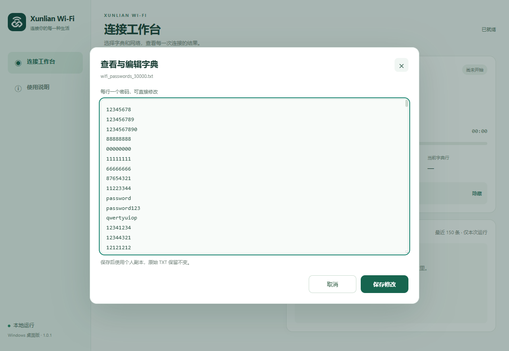
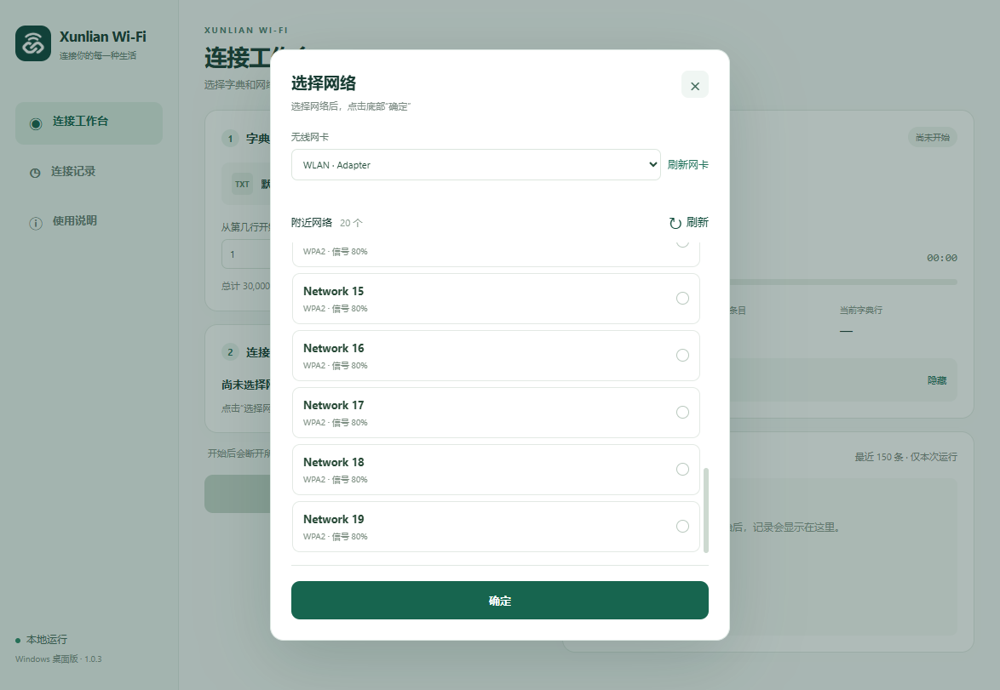
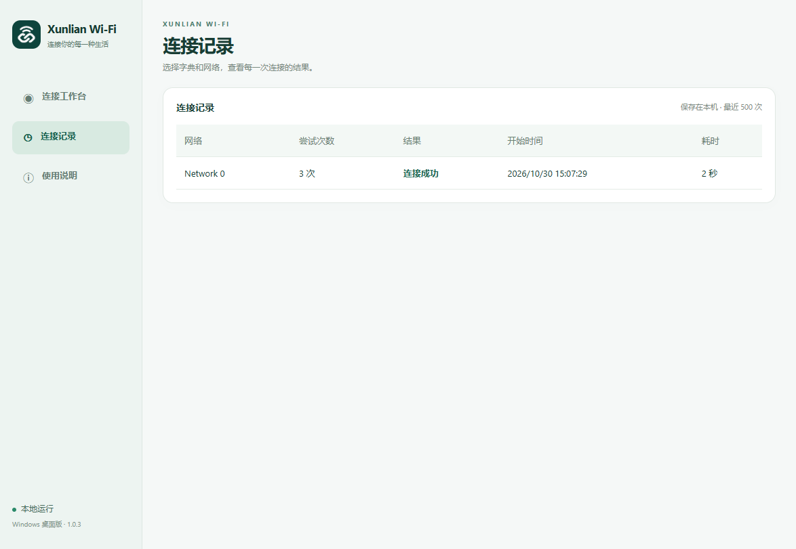

  

<h1 align="center">Xunlian Wi-Fi</h1>

Manage your Wi-Fi connections, passwords, and connection history in one place.

  <a href="https://github.com/pigpigbigperson/Xunlian_Wi-Fi/releases">Download</a>
  · <a href="#features">Features</a>
  · <a href="#screenshots">Screenshots</a>
  · <a href="#getting-started">Getting started</a>

## About

Xunlian Wi-Fi is a Wi-Fi connection tool with a simple visual interface. Manage password lists, choose a network, follow connection activity, and review the results without working in a command-line window.

The Windows and Android Root editions can check entries from a password list against a network you own or have permission to manage. The iOS edition uses a network name and a known password that you enter, with confirmation from the system.

## Features

### Manage your password lists

View and edit a dictionary directly in the app, or import your own TXT file. Keep one password per line and update your list whenever you need to.

Windows includes a 30,000-entry dictionary. Android and iOS include five scene dictionaries—Home, Office, Public Spaces, Campus, and Hotels—with 5,000 entries each and support for custom scenes. These are editable starting lists, not verified rankings of common passwords.

### See what is happening

Windows and Android show connection activity, elapsed time, and attempt counts. You can choose a starting row in your dictionary and end a task manually. When a connection is confirmed, the result stays available to review.

### Find your network

On Windows and Android, browse nearby Wi-Fi networks and select the one you want to connect to. Windows keeps network selection in a separate dialog, with a confirmation button below the list.

On iOS, enter the network name and known password manually, then approve the system's connection request.

### Review previous connections

Open connection history to see previously selected networks, task outcomes, and connection details. Records are stored on your device; no account or cloud service is required.

## Screenshots

### View and edit a dictionary

Open a password list in the built-in editor and save your changes without leaving the app.

### Choose a network

Select a wireless adapter, refresh nearby networks, and confirm your selection.

### Connection history

Review the network name, attempt count, result, and duration of previous tasks.

*Desktop interface captures with example data. Some details differ between versions. The current app interface is in Chinese.*

## Download

Visit the [Releases page](https://github.com/pigpigbigperson/Xunlian_Wi-Fi/releases) and choose the file for your device under **Assets**.

| Platform | Available download | What you need |
| --- | --- | --- |
| Windows | `.exe` installer | Windows x64 and a wireless network adapter |
| Android | `.apk` installer — Root edition | Android 13 or later, an already-rooted device, and Root access granted to the app |
| macOS | Apple Silicon source package | No ready-to-install Mac application is available yet |
| iOS | iPhone source project | No ready-to-install iPhone application is available yet |

**The macOS and iOS ZIP files are source packages, not installers.** They require building and signing as appropriate before use. Their native builds and device behavior have not yet been verified.

## Getting started

### Windows

1. Download and run the Windows installer, then open **Xunlian Wi-Fi**.
2. Keep the default dictionary or select a TXT file. Click **查看** (View) to open and edit its contents.
3. Set the starting row, connection timeout, and interval as needed.
4. Open **选择网络** (Select network), choose your wireless adapter and network, then click **确定** (Confirm).
5. Click **开始连接** (Start connection). Follow the elapsed time, attempt counts, and running log.
6. Review the result, or click **结束** (End) to stop. Open **连接记录** (Connection records) to view previous tasks.

Starting a task can interrupt the selected adapter's current connection. If the task ends without success, the app attempts to restore the previous connection; restoration is not guaranteed.

### Android Root edition

1. Install the APK on an already-rooted Android device.
2. Open the app, complete **检查并申请 Root** (Check and request Root), and grant the permissions shown on screen.
3. Choose a scene, review or edit its dictionary, and select the starting row.
4. Select your network and start the task.
5. Review the result on the connection page, or end the task after confirmation. Previous results are available under **历史记录** (History).

The APK does not root your phone. Background and screen-off operation depend on device permissions, power settings, and the phone's system behavior. Root compatibility varies between devices.

### iOS edition

Once a signed build is installed, choose a scene, enter the exact network name and a known password, then allow the system to join the network. The result remains on the third step and is recorded locally.

iOS supports dictionary viewing and editing, but **does not scan nearby networks or automatically try dictionary passwords**. It cannot skip the system's connection approval or guarantee continuous background execution.

## Your data

- No registration or backend account is needed.
- Dictionaries and connection records are stored locally.
- Windows running logs can display the password currently being submitted; keep that in mind when sharing screenshots.
- Android and iOS history uses local cache storage, which may be cleared by the system. Uninstalling an app can remove its local data.

## Questions

**Does every platform have the same features?**  
No. Windows and Android Root support dictionary-based connection tasks. iOS uses a manually entered known password and system approval. The Mac source package is intended to provide the desktop workflow, but its native behavior remains unverified.

**Does a timeout mean the password is wrong?**  
No. It means the app did not confirm a connection within the observation period. Network availability and system behavior can also affect the result.

**Can I install the Android APK without Root?**  
You can install it, but this release requires Root authorization to run connection tasks.

**How do I report a problem?**  
Open an [issue](https://github.com/pigpigbigperson/Xunlian_Wi-Fi/issues) with your app version, device model, operating system version, and the steps that led to the problem. Remove passwords and other private information from screenshots or logs before sharing them.
